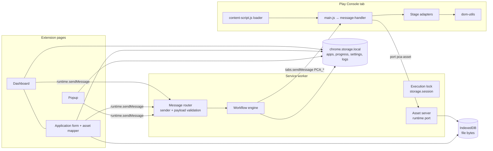

# Architecture

## Overview



| Layer | Path | Responsibility |
|---|---|---|
| Data | `src/data/schema.js` | Schema v1, defaults, field validators, ready-level validation, migration, field labels |
| | `application-repository.js` | One key per app (`app:<id>`); `saveUserEdits` keeps the engine-owned sections; duplicate |
| | `progress-repository.js` | Detailed checkpoint per app (`progress:<id>`) |
| | `asset-repository.js` | File bytes in IndexedDB, scoped by `appId`; in-memory backend for tests |
| | `settings-repository.js` | Approval gate, retries, timeouts, account index, filename conventions |
| Services | `file-validation.js` | Magic bytes; PNG IHDR/tRNS; JPEG SOF; ZIP central directory; protobuf manifest → package / version code |
| | `asset-discovery.js` | Filename-convention matching; ambiguity, conflict and duplicate detection |
| | `export-import.js` | Versioned backup; import plan (add / overwrite / invalid / package conflicts) |
| | `messaging.js` | Message contracts, sender checks, base64 chunking |
| | `logger.js` | Structured ring-buffer log with redaction |
| | `errors.js` | `PCAError`, error codes, classification (retryable / userAction / fatal) |
| | `ui.js` | Safe DOM builder (text nodes only), confirm dialog |
| Automation | `workflow-states.js` | States, stages, legal transition table |
| | `workflow-engine.js` | Stage/step execution, approval gate, guards, verification, submission token, recovery |
| | `checkpoint-manager.js` | Atomic app + progress writes, validated transitions, history |
| | `retry-policy.js` | Bounded retries; idempotent steps only; verify-before-retry hook |
| | `execution-lock.js`, `task-runner.js` | One app at a time; one job per tab |
| Content | `content-script.js` | Classic loader (content scripts can't be ES modules); forwards `PCA_*` only from this extension |
| | `message-handler.js` | Detect / inspect / apply / verify on the current document; re-checks the page type and app ID for every call |
| | `page-detector.js` | URL + heading detection, URL templates (UNVERIFIED) |
| | `dom-utils.js` | Accessible-name lookup, typed setters with read-back, waits, validation errors |
| Adapters | `src/adapters/*` | Declarative steps per stage: `buildPayload`, `inspect`, `apply`, `verify`, plus flags |

## Step protocol

Every step of every stage goes through the same sequence in `workflow-engine.js#runStep`:

1. **Uncertain-action check.** If a non-idempotent step was clicked before but never verified, and the step is marked `onUncertain: 'verify'`, the engine only looks at the current page. It never clicks again.
2. **Ensure page.**
   - Detect what the tab currently shows.
   - Stop on a signed-out page.
   - Check the developer account, then the Play Console app ID (for app-level pages).
   - Navigate with a URL template if one exists, then poll with a bound until both the URL and the heading match.
   - Read-only steps reload the page first, so they never trust stale content.
3. **Inspect (no writes).** The content side returns a report of fields (found / ambiguous / missing, current vs planned value) and blocking issues: unknown questions, existing content, and unanswered declarations. Any blocking issue stops the step as `NEEDS_USER_ACTION`.
4. **Gate.**
   - **Plan approval:** the SHA-256 of (stage, step, payload, report fields) must match a hash the user approved.
   - **Submission:** a single-use token created by the typed-name confirmation, bound to app + tab + Play Console app ID, expiring after 5 minutes.
5. **Guard.** Before a non-idempotent apply, the engine records `guards["STAGE:step"]`.
6. **Apply**, with the retry policy. Only idempotent steps are retried, and before each retry the page is verified in case the previous attempt actually worked. A lost response (navigation tore down the content script, or a timeout) is treated as an *uncertain* outcome and resolved by verification, never by repeating the action.
7. **Verify.** Depending on the step:
   - wait for the expected next page (navigation steps); or
   - reload, then read the values back (`verifyAfterReload`); or
   - read the values back directly.
   Only then is the step recorded as complete. After app creation, the new app's ID, taken from the URL, is linked only if the page shows the exact app name.

## States

The workflow states are internal to the extension and are not Google statuses. Legal transitions are defined in `TRANSITIONS`:

```
DRAFT → VALIDATING_DATA → READY_TO_START → APP_CREATION_IN_PROGRESS → APP_CREATED
→ STORE_LISTING_IN_PROGRESS → STORE_LISTING_COMPLETED → APP_CONTENT_IN_PROGRESS → APP_CONTENT_COMPLETED
→ RELEASE_IN_PROGRESS → RELEASE_READY → REVIEW_READINESS_CHECK → READY_FOR_REVIEW
→ SUBMISSION_CONFIRMATION_REQUIRED → SUBMITTED
```

- Any `*_IN_PROGRESS` state can go to `PAUSED`, `NEEDS_USER_ACTION` or `FAILED`.
- `SUBMITTED` can be reached only from `SUBMISSION_CONFIRMATION_REQUIRED`.
- Cancelling the confirmation returns to `READY_FOR_REVIEW`.
- A user-confirmed reset is the only forced transition, and it is recorded in the history.

## Stage and step table

| Stage | Step | Page | Flags | Writes |
|---|---|---|---|---|
| CREATE_APP | precheck | APP_LIST | navigation, no approval | opens Create app form; blocks on same-name app |
| | fill-form | CREATE_APP | — | name, language, app/game, free/paid, the two declarations (only if `true`) |
| | submit-create | CREATE_APP | non-idempotent, `onUncertain: verify`, navigation | clicks Create app once |
| | verify-linked | APP_DASHBOARD | (engine) | none — used when the record is already linked |
| STORE_LISTING | listing-text | STORE_LISTING | verify after reload | name, short/full description, video URL |
| | listing-graphics | STORE_LISTING | non-idempotent, reinspect, verify after reload | uploads; stops if images already exist |
| | store-settings | STORE_SETTINGS | verify after reload | category, email, phone, website |
| APP_CONTENT | privacy-policy / ads / app-access | respective pages | verify after reload | only explicit answers |
| | sections-check | APP_CONTENT_OVERVIEW | read-only | none |
| RELEASE | open-release | TRACK | non-idempotent, reinspect, navigation | creates draft release once |
| | upload-bundle | RELEASE_EDIT | non-idempotent, reinspect | uploads AAB, waits for its version code |
| | release-details | RELEASE_EDIT | verify after reload | release name, notes `<lang>…</lang>` |
| REVIEW_READINESS | dashboard-tasks, publishing-overview | APP_DASHBOARD, PUBLISHING_OVERVIEW | read-only | none |
| SUBMISSION | send-for-review | PUBLISHING_OVERVIEW | confirmation token, non-idempotent, verify after reload | send + dialog confirm |

## Storage

| Store | Key | Content |
|---|---|---|
| `storage.local` | `app:<id>` | Application record (schema v1). The stable ID is a UUID, independent of the package name. |
| | `progress:<id>` | Completed steps, guards, approvals, required action, readiness summary, last inspection report, history (50 entries) |
| | `settings` | Settings |
| | `logs` | Last 2000 structured log entries |
| `storage.session` | `executionLock` | `{ appId, tabId }` of the running job |
| IndexedDB `pca-assets` | `assets` store | `{ id, appId, role, fileName, mimeType, size, bytes }` |

Directory handles are not stored. Bytes are copied in when you save, so a browser restart never needs folder permission again. To change files, select the folder again.

## Security

- **Permissions:** `storage` and `unlimitedStorage`; host access only to `https://play.google.com/console/*`. There is no `tabs` permission, so a tab URL is visible only while it is on Play Console. A hidden URL is treated as "left Play Console / signed out".
- **No exposure to web pages:** no `externally_connectable`, no `onMessageExternal`.
- **Message checks:**
  - Page messages must come from `chrome-extension://<id>/`.
  - Content messages must come from frame 0 of a `https://play.google.com/console/` tab.
  - Each type has a payload validator.
- **Asset port:** serves a file only to the tab holding the execution lock, and only if the asset belongs to the app being automated there.
- **Web-accessible resources:** the content-side modules (no secrets), exposed only to `https://play.google.com/*`. A Play Console page could detect that the extension is installed.
- **Rendering:** all user strings are inserted as text nodes. The extension-page CSP is `script-src 'self'`; the smoke test confirms inline handlers are blocked.
- **Logs:** structured; keys like password, token, cookie, auth and session are redacted. Payload text (descriptions, declarations) is not logged.
- **No network:** no telemetry and no external requests.

## Recovery

- **Long waits:** during a long apply (uploads, bundle processing), the content script sends a progress heartbeat every 20 s so the service worker is not stopped while idle. This is UNVERIFIED in a long live run and has no automated test.
- **Service worker killed anyway:** the next start pauses the app as `INTERRUPTED`. Re-inspection then sees a bundle that is already listed and does not upload it again.

- On service worker start, `recoverOnStartup()` releases the lock and moves any `*_IN_PROGRESS` app to `PAUSED`, with `INTERRUPTED` and `pausedFrom` recorded.
- Resume re-detects the page and identity before acting.
- Guards for non-idempotent clicks survive resets. Combined with the Play Console link, this prevents duplicate app creation and duplicate draft releases.

## Future: official API

The [Google Play Developer API](https://developers.google.com/android-publisher) (`edits.listings`, `edits.images`, `edits.bundles.upload`, `edits.tracks`, `edits.commit`) covers listing text, graphics, bundle upload and track releases for **existing** apps. It cannot create apps or answer App content declarations. A future version could move stages 2 and 4 to the API, using OAuth with the user's own Google Cloud project, and keep UI assistance for app creation and declarations.
